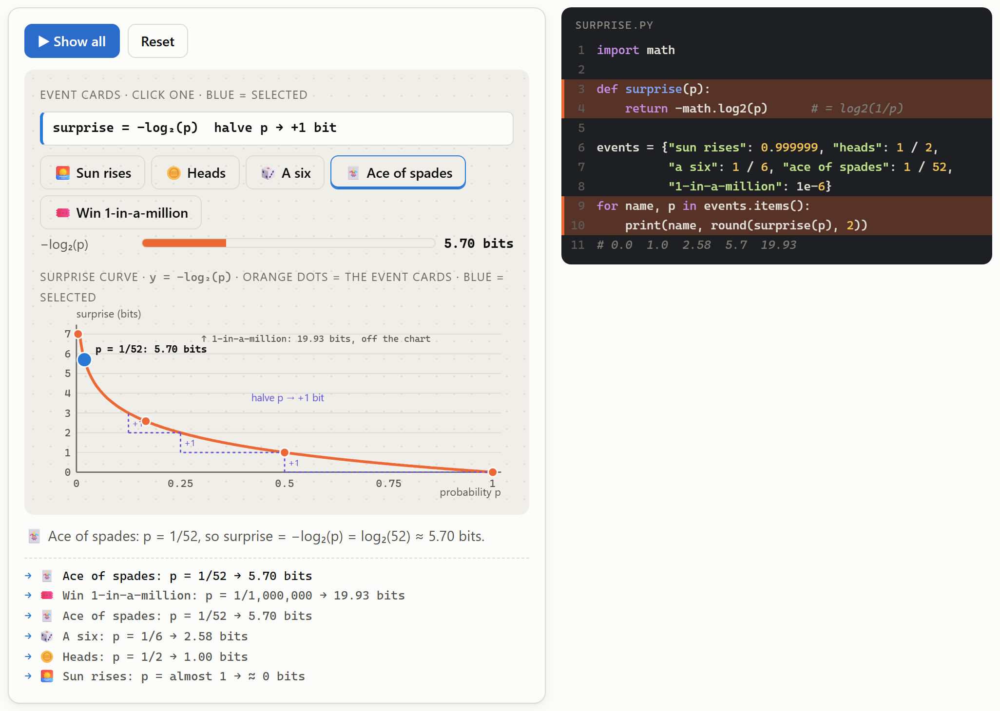
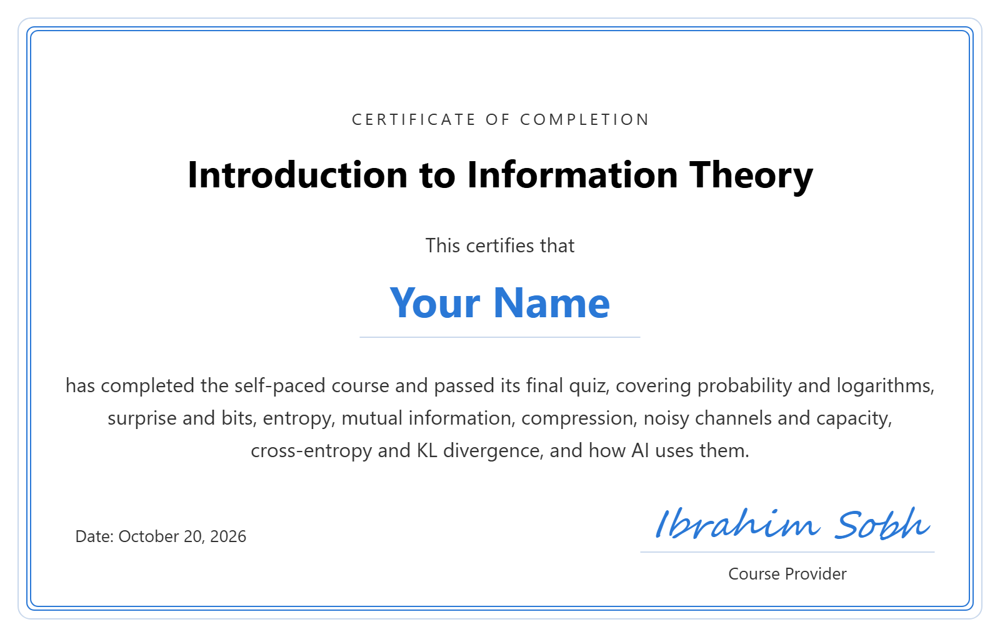

# Introduction to Information Theory

A **self-paced online course, completely free**, that teaches the ideas behind every phone call, ZIP file and AI model: what information is, how to measure it in bits (surprise and entropy), how much two things share (mutual information), how it is compressed and protected from noise, and how cross-entropy and KL divergence are used to train and score AI models. High-level and intuition-first: only school math needed (probability and logs are taught in lesson 1), no proofs and no coding.

<i>Created by <a href="https://www.linkedin.com/in/ibrahim-sobh-phd-8681757/">Ibrahim Sobh, PhD</a></i>

**The certificate is free too.** No sign-up and no fees: pass the final quiz and get a certificate with your name.

## 🚀 Take the course: [ibrahimsobh.github.io/introduction-to-information-theory](https://ibrahimsobh.github.io/introduction-to-information-theory/)

✅ Free · no sign-up · runs in your browser

## 🎞️ Presenting it? Use the slides: [ibrahimsobh.github.io/introduction-to-information-theory/slides.html](https://ibrahimsobh.github.io/introduction-to-information-theory/slides.html)

**20 ready-to-present slides** that follow the course: one key message and a clear diagram per topic, with 🗣️ speaker notes. Made for teachers, trainers and anyone giving a talk on information theory.

⌨️ **←** / **→** move · **N** speaker notes · **T** light or dark · **F** full screen · 🖨️ **Ctrl + P** save as PDF

📄 **[Download the slides as PDF](https://ibrahimsobh.github.io/introduction-to-information-theory/introduction-to-information-theory-slides.pdf)** (20 pages, one slide per page, clickable links)

## What you'll learn

- What information is, and how bits and entropy measure surprise and uncertainty.
- The big ideas behind compression and error correction, through intuition, not proofs.
- How cross-entropy, KL divergence and mutual information power modern AI models.

## Main audience

Beginners who want an intuitive, concept-first introduction to information theory. Only school math is needed: probability and logarithms are taught from scratch in lesson 1.

- **Learners heading into AI and machine learning** who keep meeting cross-entropy loss, KL divergence, perplexity and information gain and want to know what they really mean.
- **Students of computer science, engineering, data science or statistics** who want the intuition before a formal course.
- **Developers and engineers** who work with compression, networking, storage or data and want to understand the limits behind them.
- **Curious adults** who want to know what a "bit" really is and how phones, ZIP files and AI models use the same few ideas.

It isn't aimed at readers looking for proofs, coding theory in depth, continuous (differential) entropy or exam-style problem drills.

## Course outline

**Part A · Measuring information**

1. **Probability and logs**: probabilities from 0 to 1, powers of 2 and log₂ (how many bits b give 2ᵇ codes), why log₂ of a fraction is negative, expected value, and a loaded die whose probabilities always add up to 100%
2. **What is information?**: Shannon's idea that information is what reduces uncertainty, the communication model (source, encoder, channel, decoder, receiver), a message sent as 8-bit ASCII through a noisy channel, information vs. meaning, and Shannon's two big questions
3. **Surprise and the bit**: the bit as one fair yes/no answer, surprise (self-information) −log₂(p), the surprise curve with five everyday events from the sun rising to a 1-in-a-million win, and why halving p adds exactly one bit
4. **Entropy**: entropy as average surprise, a coin whose bias you sweep along the entropy curve, four-outcome weather, the three properties of entropy, and the entropy of English
5. **Shared information**: joint entropy, conditional entropy and mutual information I(X;Y), shown with the weather and a neighbour's umbrella as two overlapping circles

**Part B · Using information**

6. **Compression**: short codes for common symbols (Morse code, Huffman coding), entropy as the limit for lossless codes, three texts compared in bits per letter, why random data won't compress, and lossless vs. lossy
7. **Noisy channels**: noise that flips bits, redundancy, a parity bit that detects errors vs. repeat ×3 that fixes them, and channel capacity as the speed limit for reliable messages
8. **Cross-entropy and KL divergence**: the cost of a wrong belief, step by step with red, green and blue balls, why H(p,q) ≠ H(q,p) and KL(p‖q) ≠ KL(q‖p), your belief vs. the real weather, and the link with compression
9. **Information theory in AI**: cross-entropy loss for a classifier, information gain in a decision tree, perplexity of a language model, and uses beyond AI

## What each lesson gives you

- **A clear explanation** of the main idea, with an everyday analogy, simple diagrams and comparison tables. Every formula comes with a worked example in real numbers, and a formula strip above each demo shows the calculation it runs.
- **Interactive demos** you drive yourself: list every code b bits can write, load a die, send a message through a noisy channel, turn everyday events into bits, sweep a coin across the entropy curve, overlap two information circles, compress a text, protect bits from noise, compare a belief with the truth, and score a classifier, a decision tree and a language model.
- **Short Python sketches** beside each demo, with the step being run highlighted, so you see the same calculation as code (you don't need to run them).
- **A quiz in every lesson** (27 questions in total), plus a glossary to revise from.

**Example: surprise and the bit.** Five event cards, from the sun rising to winning a 1-in-a-million draw, turn their probabilities into bits. Here "Ace of spades" is selected: p = 1/52 gives a surprise of 5.70 bits, its blue dot sits on the surprise curve with the dashed "halve p → +1 bit" steps below it, and the `surprise(p)` lines of the Python code are highlighted.

## How long it takes

About 3¾ hours if you're new to the topic, or about 2 hours if you already know some maths or AI.

| Part | New to the topic | Already know some maths or AI |
|---|---|---|
| Part A: 5 lessons | 25 + 4 × 20 min = 105 min | 13 + 4 × 10 min = 53 min |
| Part B: 4 lessons | 2 × 20 + 2 × 25 min = 90 min | 2 × 10 + 2 × 13 min = 46 min |
| Glossary review | 10 min | 5 min |
| Final quiz and certificate | 15 min | 10 min |
| **Total** | **220 min ≈ 3¾ hours** | **114 min ≈ 2 hours** |

## Final quiz and certificate

Finish with the final quiz: 12 questions on the main concepts. Score 10 of 12 or more (80%) to get a certificate with your name, which you can download as an image or save as a PDF and share.

**Here's what your certificate looks like:**

Everything runs in your browser. Nothing you enter, including your name, is sent anywhere.
